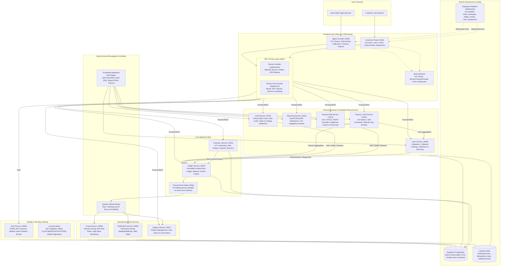

# System Architecture: Novo Bank Service PLC

Novo Bank is an enterprise-grade retail and commercial banking platform prototype built with **Spring Boot 3.2.12 (Java 17)** and **Next.js 14 App Router (TypeScript)**. The architecture adheres to domain-driven design, immutable double-entry bookkeeping, multi-stage financial settlement, event-driven reactive messaging, and strict boundary isolation across 11 backend microservices and 2 frontend web portals.

---

## 1. High-Level Architecture Diagram



A standalone version is maintained in [architecture.mmd](architecture.mmd).

---

## 2. Frontend Monorepo Architecture

The frontend is structured as a modern **npm workspaces monorepo** consisting of two Next.js 14 App Router applications and a shared package `@novo/shared`.

```
apps/
  ├── customer-portal/       # Next.js 14 App Router (:3100)
  └── agent-console/         # Next.js 14 App Router (:3200)
packages/
  └── shared/                # Core TypeScript interfaces, API clients, utilities
```

### 2.1 Backend-for-Frontend (BFF) & Security Pattern

Client applications never handle long-lived JWT access tokens or refresh tokens directly in browser storage (`localStorage` or `sessionStorage`), which mitigates Cross-Site Scripting (XSS) token exfiltration vulnerabilities.

1. **HttpOnly Cookie Authentication**:
   - `/api/session` route handlers manage session cookies marked `HttpOnly`, `Secure`, `SameSite=Lax`.
   - On login, access and refresh tokens returned by `auth-server (:3008)` are sealed inside the server-side cookie jar.
   - When calling backend microservices, client requests hit `/api/proxy/[service]/*`.
2. **Reverse Proxy & Header Injection**:
   - The Next.js BFF extracts the JWT from the incoming session cookie, attaches an `Authorization: Bearer <jwt>` header, and transparently forwards the request to the target backend microservice port (`:3003` - `:3013`).
3. **Session Idle Timeout Management**:
   - `SessionTimeoutProvider` tracks user activity (keyboard, mouse movement, clicks) with a configurable **15-minute idle threshold**.
   - At the 14-minute mark, an interactive modal warns the user with a 60-second countdown.
   - If no activity occurs before countdown expiration, the provider triggers a POST to `/api/session/logout` and redirects the user to `/login`.
4. **Client-Side Role Guards**:
   - `roleGuard.tsx` wraps protected views, ensuring users with `ROLE_CUSTOMER` cannot view back-office console views, and `ROLE_STAFF` users are directed to agent console workflows.

### 2.2 Live WebSocket Updates with Supabase Realtime

The Next.js applications leverage Supabase Realtime WebSocket subscriptions for reactive banking updates without polling:
- **Support Chat (`ticket_messages`)**: Both customer and agent views subscribe to `postgres_changes` on `ticket_messages` filtered by `ticket_id`, streaming incoming customer replies and staff updates immediately into the chat thread.
- **Transaction Details (`ledger_entries`)**: Subscribes to entry status changes, immediately showing balance updates once an outbox transfer clears.
- **Collections Worklist (`loan_repayments`)**: Automatically reflects repayment status transitions (`PENDING` -> `OVERDUE` -> `PAID`) in real time across agent workstations.

### 2.3 Page & Feature Directory

#### Customer Portal (`apps/customer-portal` :3100)
- `/dashboard`: Consolidated account balances, recent transactions, quick actions.
- `/transfer`: Internal account-to-account transfer with Redis idempotency check.
- `/transactions/[id]`: Transaction details, double-entry breakdown, live Realtime status.
- `/loans`: Retail loan catalog, current loan status, collateral pledges, repayment schedule.
- `/loans/apply`: Multi-step loan application wizard with collateral valuation details.
- `/loans/applications/[id]`: Repayment execution, amortized breakdown, collateral pledge status.
- `/cards`: Virtual debit card issuance (masked Luhn-16), freeze/unfreeze controls.
- `/external-payments`: External transfer wizard (ACH, RTGS, SWIFT) with routing numbers and transaction history.
- `/statements`: Customer account statement generation (PDF) with presigned download links.
- `/support`, `/support/new`, `/support/[id]`: Dispute ticketing with real-time staff messaging.
- `/profile`: Customer KYC status, AML risk tier, contact details.

#### Agent Console (`apps/agent-console` :3200)
- `/dashboard`: High-level operational metrics, ticket queues, pending loan counter.
- `/kyc-queue`: Customer onboarding files, AML risk rating adjustments, KYC approve/reject.
- `/loans/review`: Loan underwriting queue, debt-to-income analysis, collateral inspection.
- `/loans/disburse`: Approved loan disbursement trigger to customer account.
- `/loans/[id]`: Detailed credit file, collateral details, repayment audit logs.
- `/collections`: Overdue repayments queue with real-time delinquency feed, recovery action logger (`PHONE_CALL`, `DEMAND_LETTER`, `LEGAL_NOTICE`), and typed "WRITE OFF" modal.
- `/treasury`: ALM overview, Liquidity Coverage Ratio (LCR), Net Interest Margin (NIM), interest rate gap buckets, and inline historical SVG chart.
- `/reports`: Regulatory CSV report generation (`DAILY_TRANSACTION_SUMMARY`, `LOAN_PORTFOLIO`, `KYC_STATUS`).
- `/tickets`, `/tickets/[id]`: Customer dispute triage and real-time message response desk.

---

## 3. Backend Microservices Architecture

### 1. Auth Service (`:3008`, `auth-server/`)
- **Role**: Identity authority and token issuer.
- **Responsibilities**:
  - Issues RS256 signed JSON Web Tokens (15-minute TTL) with claims: `sub` (userId), `cid` (customerId), `roles` (`ROLE_CUSTOMER`, `ROLE_STAFF`).
  - Implements opaque refresh token rotation with reuse detection (revoking token family on breach).
  - Maintains token revocation blacklist in Redis (`revoked:jti:{jti}`).
  - Credential verification using BCrypt with salt rounds.

### 2. Customer Service (`:3003`, root `src/`)
- **Role**: Customer master data and onboarding compliance.
- **Responsibilities**:
  - Manages customer lifecycle: `UNVERIFIED` -> `PENDING` -> `VERIFIED` / `REJECTED`.
  - AML risk rating classification (`LOW`, `MEDIUM`, `HIGH`).
  - Synchronous account aggregation via internal Ledger client (`GET /api/accounts?customerId=`).

### 3. Ledger Service (`:3004`, root `src/`)
- **Role**: Double-entry book of record and transaction engine.
- **Responsibilities**:
  - Enforces immutable double-entry bookkeeping: every transaction consists of balanced debits and credits.
  - Balance validation: prevents overdrafts on customer deposit accounts.
  - Manages internal system settlement accounts (`CARD_SETTLEMENT`, `MERCHANT_SETTLEMENT`, `RAIL_SETTLEMENT`, `LOAN_DISBURSEMENT`).
  - Transactional Outbox pattern: writes domain events to `outbox` within the database transaction; scheduled outbox relay polls every 5s and forwards events to Upstash QStash topic `banking-events`.

### 4. Fraud Service (`:3005`, `fraud-service/`)
- **Role**: Real-time and asynchronous transaction risk scoring.
- **Responsibilities**:
  - Consumes QStash webhook `POST /webhooks/transfer-completed`.
  - Rule evaluation:
    - Velocity Engine: flags accounts exceeding frequency thresholds ($N$ transfers per minute).
    - High-Value Rule: flags transfers exceeding $10,000.00.
    - AML Classifier: correlates customer AML risk tier with transaction velocity.
  - Emits `fraud-alert` events to QStash, automatically triggering dispute tickets in Support Service.

### 5. Notification Service (`:3006`, `notification-service/`)
- **Role**: Customer communications dispatch.
- **Responsibilities**:
  - Consumes QStash webhooks for `customer-created` and `transfer-completed`.
  - Transaction alert emails dispatched via Spring `JavaMailSender` (configured for Mailtrap / Mailhog).
  - SMS dispatch stubs for multi-channel notification simulation.

### 6. Support Service (`:3007`, `support-service/`)
- **Role**: Customer disputes and audit logging.
- **Responsibilities**:
  - Customer ticket creation and threaded messages.
  - Automated ticket generation upon receiving `fraud-alert` events.
  - Real-time event streaming via Supabase Realtime for instant agent-customer communication.

### 7. Loan Service (`:3009`, `loan-service/`)
- **Role**: Retail lending lifecycle, collateral registry, and debt recovery.
- **Responsibilities**:
  - Product catalog management (limits, interest rates, term months).
  - Application underwriting: credit evaluation, approval, rejection.
  - Disbursement engine: calls Ledger Service via SYSTEM token to debit `LOAN_DISBURSEMENT_ACCOUNT_ID` and credit the customer account.
  - Amortization & Repayment: calculates principal and interest breakdown, debits customer account on payment.
  - **Collateral Management** (`loan_collateral` table):
    - Pledges assets for secured loans: `PROPERTY`, `VEHICLE`, `FIXED_DEPOSIT`, `SECURITIES`, `OTHER`.
    - Tracks estimated valuation cents and valuation date.
    - Manages collateral status: `PLEDGED` -> `RELEASED` or `SEIZED`.
  - **Collections & Recovery Workflows** (`collection_actions` table):
    - QStash cron (`/webhooks/loan-schedule`) marks overdue repayments.
    - Overdue collections queue (`GET /api/loans/collections/overdue`).
    - Staff action logging: `REMINDER_SENT`, `PHONE_CALL`, `DEMAND_LETTER`, `LEGAL_NOTICE`, `WRITE_OFF_PROPOSED`, `WRITE_OFF_APPROVED`.

### 8. Treasury / ALM Service (`:3010`, `treasury-service/`)
- **Role**: Balance sheet asset-liability analytics and liquidity monitoring.
- **Responsibilities**:
  - Liquidity Coverage Ratio (LCR) proxy: queries total active deposits from Ledger and active loans from Loan Service.
  - Net Interest Margin (NIM) calculation in basis points:
    $$\text{NIM} = \frac{\text{Loan Interest Income} - \text{Deposit Interest Expense}}{\text{Total Earning Assets}} \times 10{,}000$$
  - Maturity Gap Buckets: calculates asset/liability duration mismatches across `<1m`, `1-3m`, `3-12m`, `1-5y`, and `>5y`.
  - Scheduled daily snapshots persisted in `treasury_snapshots`.

### 9. Reporting Service (`:3011`, `reporting-service/`)
- **Role**: Asynchronous statement generation and regulatory extracts.
- **Responsibilities**:
  - Customer PDF statements: renders account statements from HTML templates via OpenHTMLtoPDF.
  - Regulatory CSV extracts: `DAILY_TRANSACTION_SUMMARY`, `LOAN_PORTFOLIO`, `KYC_STATUS` via OpenCSV.
  - Cloud file persistence: uploads rendered artifacts to Supabase Storage and generates presigned download URLs with 24-hour expiration.
  - Background execution worker (`POST /webhooks/report-worker`) triggered every 60s by QStash.

### 10. Payment Rail Service (`:3012`, `payment-rail-service/`)
- **Role**: External clearing house and payment network simulator.
- **Responsibilities**:
  - Outbound transfers across simulated networks:
    - `ACH`: Limit $10,000, 3 ticks (~90s latency).
    - `RTGS`: Limit $1,000,000, 1 tick (~30s latency).
    - `SWIFT_SIM`: Limit $5,000,000, 2 ticks (~60s latency).
  - Synchronously debits customer account to `RAIL_SETTLEMENT_ACCOUNT_ID` via Ledger Service and enters `PROCESSING` status.
  - Scheduled rail processor (`POST /webhooks/rail-processor` every 30s):
    - Increments Redis tick counters.
    - Simulates 10% network decline rate; automatically issues compensating reversal transfers from `RAIL_SETTLEMENT_ACCOUNT_ID` back to customer account (`ext-reverse-{paymentId}`).
  - Inbound webhook (`POST /webhooks/inbound-payment`): credits destination customer account from `RAIL_SETTLEMENT_ACCOUNT_ID`.

### 11. Card Service (`:3013`, `card-service/`)
- **Role**: Virtual debit card issuance and 4-stage card settlement simulation.
- **Responsibilities**:
  - Virtual Card Issuance (`POST /api/cards`):
    - Generates 16-digit Luhn-valid card numbers, 3-digit CVVs, and 4-year expiration dates.
    - Security invariant: Plaintext is NEVER stored or returned; only SHA-256 hashes (`card_number_hash`, `cvv_hash`) and masked strings (`****-****-****-1234`) are persisted.
  - Authorization & Hold (`POST /api/cards/authorize`):
    - Validates CVV hash, card status (`ACTIVE`), and daily spend limits ($5,000.00 default).
    - Synthetically calls Fraud Service for pre-auth screening.
    - Creates a Ledger hold by debiting customer account into `CARD_SETTLEMENT_ACCOUNT_ID`.
    - Generates 6-character auth code and transitions transaction to `AUTHORIZED`.
  - 4-Stage Settlement Engine (QStash Crons):
    1. `AUTHORIZED` -> `BATCHED` (`POST /webhooks/card-batch`, every 60s)
    2. `BATCHED` -> `CLEARED` (`POST /webhooks/card-clear`, every 120s)
    3. `CLEARED` -> `FUNDED` (`POST /webhooks/card-fund`, every 180s): transfers funds from `CARD_SETTLEMENT_ACCOUNT_ID` to `MERCHANT_SETTLEMENT_ACCOUNT_ID`.
    - Compensating reversals: Stage failures trigger compensating reversal transfers back to the customer's account (`card-reverse-{cardTxnId}`).

---

## 4. Shared Security Starter Library

The `security-starter` (and `shared-security-starter`) module is a shared Spring Boot library imported by all microservices to enforce uniform security:

1. **RS256 JWT Authentication**:
   - Parses `Authorization: Bearer <token>` headers.
   - Validates signatures locally using the Auth Service RSA public key (`JWT_PUBLIC_KEY`).
   - Extracts claims into an `AuthPrincipal` with authorities: `ROLE_CUSTOMER`, `ROLE_STAFF`.
2. **Inter-Service REST Authentication (SYSTEM Role)**:
   - Services communicate synchronously using HTTP headers:
     - `X-Service-Id`: Identifier of the invoking microservice.
     - `X-Service-Key`: Shared secret string matching `SYSTEM_TOKEN_SECRET`.
   - Populates `AuthPrincipal` with `ROLE_SYSTEM`, bypassing user token requirements.
3. **QStash Webhook Signature Verification**:
   - Webhook endpoints verify the `Upstash-Signature` header (HMAC SHA-256 JWT signed with current/next signing keys).
   - Validates request body hash and timestamp against clock skew (< 60s).

---

## 5. Database Schema & Migration Catalog

All microservices persist to a unified Supabase PostgreSQL database with Row Level Security (RLS) enabled:

| Migration File | Primary Tables / Objects | Purpose |
|---|---|---|
| `db/schema.sql` | `customers`, `accounts`, `transactions`, `ledger_entries`, `outbox` | Core banking, double-entry bookkeeping, append-only rules, and outbox relay. |
| `db/seed.sql` | Initial accounts and customers | Test accounts (Alice, Bob, Charlie) and system settlement accounts. |
| `db/002_fraud_alerts.sql` | `fraud_alerts` | Fraud evaluation logs and alert tracking. |
| `db/003_auth.sql` | `auth_users`, `refresh_tokens` | Authentication credentials and refresh token storage. |
| `db/005_support.sql` | `support_tickets`, `ticket_messages` | Support tickets and threaded messages. |
| `db/006_auth_server.sql` | Extended OAuth2 client tables | Extended auth provider tables. |
| `db/007_loans.sql` | `loan_products`, `loan_applications`, `loan_repayments` | Retail lending catalog, loan underwriting, and repayment schedules. |
| `db/008_treasury.sql` | `treasury_snapshots`, `alm_gap_buckets` | ALM balance sheet snapshots and gap analyses. |
| `db/009_reporting.sql` | `report_jobs` | Asynchronous PDF/CSV reporting jobs. |
| `db/010_payment_rails.sql` | `external_payments` | External transfers, routing info, and settlement stages. |
| `db/011_cards.sql` | `cards`, `card_transactions` | Virtual debit cards, hashes, daily limits, and 4-stage transactions. |
| `db/012_loan_collateral_collections.sql` | `loan_collateral`, `collection_actions` | Pledged collateral registry and collections recovery actions. |

---

## 6. Financial Integrity Invariants

1. **Balance Conservation**: Money cannot enter or leave the system without explicit ledger entries. All transactions are zero-sum pairs of debits and credits.
2. **PostgreSQL Append-Only Guard**: Database-level rules reject `UPDATE` and `DELETE` on `ledger_entries`. Ledger adjustments must be executed as new compensating transactions.
3. **Idempotency & Race Protection**:
   - High-throughput endpoints acquire Redis distributed locks on the account ID before executing balance checks.
   - Idempotency keys (`Idempotency-Key` header) prevent double-spend or duplicate charges during network retries.
4. **Dedicated System Settlement Accounts**:
   - `CARD_SETTLEMENT_ACCOUNT_ID`: Escrows funds during the virtual card clearing cycle.
   - `MERCHANT_SETTLEMENT_ACCOUNT_ID`: Terminal account receiving cleared card transaction funds.
   - `RAIL_SETTLEMENT_ACCOUNT_ID`: Terminal account for external payment rail debits/credits.
   - `LOAN_DISBURSEMENT_ACCOUNT_ID`: Bank capital source for new loan disbursements.
